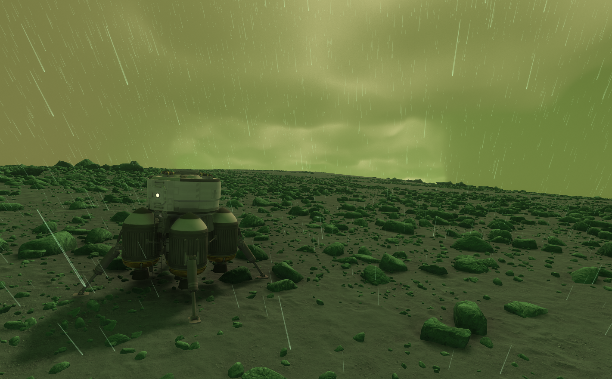

# Eos-Planetary-System

A custom planetary system mod for Kerbal Space Program 1.12.5

---

## Download

[Download Eos Planetary System v0.1.0](https://github.com/Labrujuladeian/Eos-Planetary-System/releases/tag/v0.1.0)

#Recommended Visual Mods

Enhance your exploration of the Eos system with these visual enhancements for Kerbal Space Program.

Parallax Continued

* Advanced planetary terrain textures, surface details and environmental objects.
* Requires additional dependencies and Eos-specific configurations.

Scatterer

* Atmospheric scattering, realistic lighting and improved water effects.

EVE Volumetric Clouds V3

* Volumetric clouds and enhanced atmospheric visuals.

Note: These are optional visual enhancements, not bundled with Eos. Additional planet configurations may be required. Check compatibility with your installed versions.
⸻                                                                                                                                        

About Eos

Beyond Kerbol, a new frontier awaits.

Eos is an independent planetary system located 1.2 light-years away from Kerbol, created as a new exploration destination for Kerbal Space Program.

Discover unique worlds, explore unfamiliar environments and venture into a distant star system filled with new places to explore.

Every planet has its own identity, landscapes and characteristics, offering a different experience throughout your journey.

Your next journey begins beyond Kerbol.

⸻

Bug Reports

Found a bug, graphical issue or unexpected behavior while exploring Eos?

Your feedback helps improve the mod!

When reporting a bug, please include:

* Kerbal Space Program version.
* Eos version.
* Installed dependencies and their versions.
* Screenshots or videos, if available.
* Relevant game logs (Player.log).

Contact: labrujuladeian@gmail.com

⸻

Credits

Created by Labrujuladeian.

Thank you to everyone who supports and contributes to the Eos Planetary System project.

