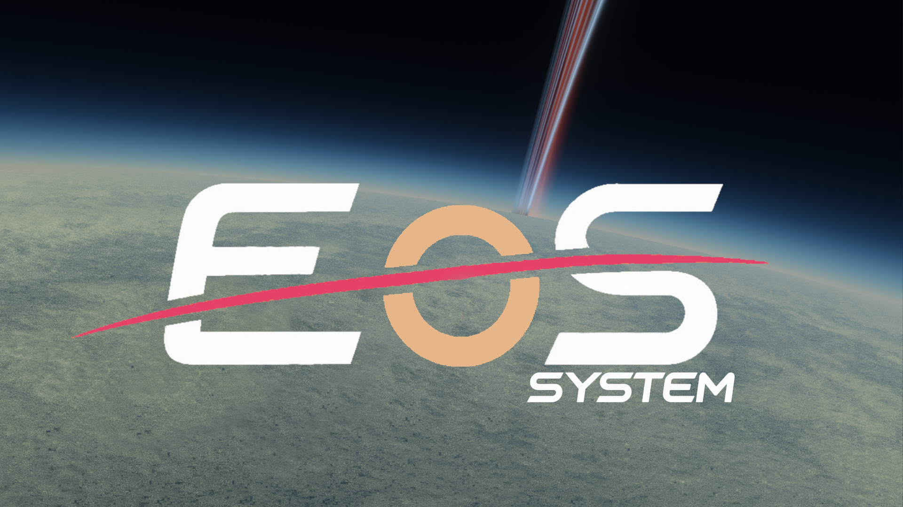

# Eos-Planetary-System

A custom planetary system mod for Kerbal Space Program 1.12.5

---

## Download

[Download Eos Planetary System v0.1.0](https://github.com/Labrujuladeian/Eos-Planetary-System/releases/tag/v0.1.0)

#Recommended Visual Mods :D

Enhance your exploration of the Eos system with these visual enhancements for Kerbal Space Program.

Parallax Continued

* Advanced planetary terrain textures, surface details and environmental objects.
* Requires additional dependencies and Eos-specific configurations.

Scatterer

* Atmospheric scattering, realistic lighting and improved water effects.

EVE Volumetric Clouds V3

* Volumetric clouds and enhanced atmospheric visuals.

Note: These are optional visual enhancements, not bundled with Eos. Additional planet configurations may be required. Check compatibility with your installed versions.
⸻                                                                                                                                        
About Eos :P

Beyond Kerbol, a new frontier awaits.

Eos is an independent planetary system located 1.2 light-years away from Kerbol, created as a new exploration destination for Kerbal Space Program.

Discover unique worlds, explore unfamiliar environments and venture into a distant star system filled with new places to explore.

Every planet has its own Eos Planetary System

Planetary Encyclopedia

The Central Star

Eos

* Type: Young orange-red dwarf star
* Orbital position around Kerbol: Apoapsis
* Distance from Kerbol: 0.0287 light-years
* Orbital velocity: 0.1 m/s
* Stellar light color: Amber-orange
* Protoplanetary disk: Present

Eos possesses an inclined, incandescent protoplanetary material disk extending from 37,800,000 km to 49,680,000 km from the stellar center.

Planetary System

1. Edr — First Planet

* Orbital distance: 12.0 Gm
* Type: Extremely dense rocky planet
* Atmosphere: Dense, toxic, without oxygen
* Surface: Extreme green rocky terrain

2. Otri — Second Planet

* Orbital distance: 18.0 Gm
* Type: Temperate desert world
* Atmosphere: Breathable, oxygen-containing
* Surface: Reddish-ochre deserts and inland seas

3. Rolo — Third Planet

* Orbital distance: 24.0 Gm
* Type: Cryogenic glacial world
* Atmosphere: Cold, breathable
* Surface: Extensive glaciers and a mineral-rich equatorial sea

4. Onru — Fourth Planet

* Orbital distance: 33.0 Gm
* Type: Ice giant
* Atmosphere: Deep gaseous envelope with complex cloud structures
* Features: Six major atmospheric vortices and an extensive icy ring system

5. Odan and Rodan — Binary Planetary System

* Barycenter orbital distance: 45.0 Gm
* Type: Binary hypervolcanic rocky planets
* Surface: Basaltic terrain, magma seas and lava channels
* Atmosphere: Thin metallic-gray atmosphere
* Environmental hazards: Extreme heat and volcanic ash

6. Manzat — Sixth Planet

* Orbital distance: 60.0 Gm
* Type: Cold oceanic super-Earth
* Atmosphere: Dense, breathable, oxygen-containing
* Surface: Deep oceans, red vegetation, rocky shores and extensive polar glaciers

Planetary Database

Each celestial body has an individual encyclopedia entry containing:

* General characteristics
* Physical properties
* Orbital parameters
* Atmosphere and climate
* Surface and geology
* Biomes and environmental conditions
* Natural satellites
* Exploration and hazards
* Official in-game screenshots

About This Encyclopedia

This encyclopedia is the official reference documentation for Eos Planetary System, a custom planetary system for Kerbal Space Program 1.12.5.

Information is based on the system’s configurations and documented planetary characteristics.

⸻

Bug Reports XP

Found a bug, graphical issue or unexpected behavior while exploring Eos?

Your feedback helps improve the mod!

When reporting a bug, please include:

* Kerbal Space Program version.
* Eos version.
* Installed dependencies and their versions.
* Screenshots or videos, if available.
* Relevant game logs (Player.log).

Contact: labrujuladeian@gmail.com

⸻

Credits

Created by Labrujuladeian.

Thank you to everyone who supports and contributes to the Eos Planetary System project :3
